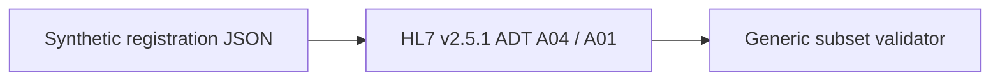

# hie-adt-feed-sample

Generate and check synthetic HL7 v2 ADT registration/admission messages.

[](https://github.com/code-rowthtech/hie-adt-feed-sample/actions/workflows/ci.yml)

Educational sample using synthetic data. The badge above reports the actual GitHub Actions status; passing local tests does not imply exchange acceptance or production readiness.

## The problem it solves

A team preparing UAE HIE onboarding needs to understand event fields, patient identifiers and visit context without sending real patient records.

All bundled sample data is invented and synthetic. No real people, production exports, client code or credentials are included. This is a working scoped sample, not a production implementation.

## How it works



The output above is abbreviated. `build()` returns HL7 carriage-return segment separators. The CLI displays one segment per line for readability; the validator also accepts that display format. Supported events are A04 (outpatient registration) and A01 (inpatient admission), with MSH/EVN/PID/PV1 fields, unique control IDs, visit ID at PV1-19 and event time at PV1-44. Input delimiter injection and invalid dates are rejected. MSH-11 is T for training, never P.

```bash
python3 -m src.cli --event A01
```

This sample has no live exchange transport. Its validator checks a documented generic subset and does not claim acceptance by either exchange. Malaffi's official resources page offers message guides by request; a current facility-specific guide was not available for complete review. Public NABIDH policy material was reviewed, but it is not a replacement for the current inbound specification. The sample is ready to run as a generic offline educational example. Current exchange-specific guide validation, onboarding and acceptance testing are separate work for a real exchange connection.

## Run it in 3 commands

Python 3.11+; no third-party dependencies. Use Python 3.12 to match CI. Run these from this repository's directory after cloning/extracting it:

```bash
python3 --version
python3 -m unittest discover -s tests -v
python3 -m src.cli
```

Dependencies may need an initial internet download. Default examples use only bundled synthetic data and local processing. Nothing is sent to a healthcare exchange. Environment templates list names only and contain no values; offline samples need no environment variables.

## Sample input and output

`sample-data/registration.json` with deliberately invalid-for-production SYNTHETIC identifiers.

Expected summary (or abbreviated structured output):

```text
MSH|^~\&|SYNTHETIC_EMR|SYNTHETIC-FACILITY|HIE|SYNTHETIC_RECEIVER|...||ADT^A04^ADT_A01|...|T|2.5.1
EVN|A04|...
PID|1||SYNTHETIC-MRN-001...
PV1|1|O|...
```

Full output examples are under `sample-data/expected-output.hl7` when applicable. Generated artifacts go to ignored `output/`. Tests cover valid data and meaningful negative cases; the CI workflow runs tests, the demo command, TypeScript checks where relevant, and Gitleaks.

## What we would add in production

Obtain current authorized Malaffi and NABIDH inbound guides, agree facility identifiers/code tables, validate every required field/profile, add ACK/NACK handling, MLLP/TLS transport, durable delivery/retries, reconciliation and integration certification.

## Built by RowthTech

Healthcare software engineering samples, independently written for this portfolio. MIT licensed. Priority: P0; market: GCC.

Primary references consulted on 13 November 2026:

- [https://www.malaffi.ae/providers/resources/](https://www.malaffi.ae/providers/resources/)
- [https://www.doh.gov.ae/en/resources/HIE](https://www.doh.gov.ae/en/resources/HIE)
- [https://dha.gov.ae/uploads/102022/NABIDH%20Policies%20%26%20Standards%20-%20Interoperability%20and%20Data%20Exchange%20Standards2022100429.pdf](https://dha.gov.ae/uploads/102022/NABIDH%20Policies%20%26%20Standards%20-%20Interoperability%20and%20Data%20Exchange%20Standards2022100429.pdf)

Before public release: clean-clone run, clean Gitleaks scan, second-engineer review, and approval from Mukesh or Raavish. For a real GCC integration, validate against the current authorized exchange guide and complete onboarding/sandbox checks. Those activities are outside this offline sample. No approvals or exchange acceptance are implied by local tests.
